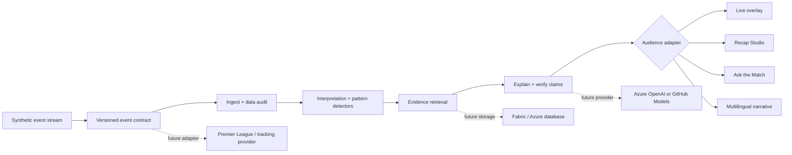

# MatchMind

MatchMind is an explainable football-intelligence workspace for live match coverage. It transforms synthetic football events into context-rich statistics, tactical explanations, broadcast-ready overlays, historical trends, and personalized stories for different kinds of fans.

The central product idea is simple: football stories do not start and end with the scoreline. MatchMind explains what changed, why it mattered, how it compares with previous matches, and how the same intelligence should be communicated to an analyst, casual fan, broadcaster, or social editor.

## What the website does

MatchMind presents a fictional Atlético Norte vs Real Bahía match using coherent synthetic data. It is a hackathon demonstration environment, not a live sports-data subscription and not a source of real-world match facts.

The live workspace includes a match clock, scoreline, pitch visualization, player positions, passing lanes, pressure triggers, a recent event feed, momentum and rhythm signals, pass-quality metrics, ball-speed metrics, expected-threat changes, player focus, and an explainable “Moment Decoded” panel.

The historical workspace uses five synthetic previous matches to calculate form, points, average possession, pass accuracy, shots per match, expected goals, pressure recoveries, and distance covered. Users can select an individual match or compare the five-match baseline.

The narrative workspace supports Analyst mode and Casual fan mode, plus persona-specific moment copy for Analyst, Casual fan, Broadcaster, and Social editor. Language switching is available for English, Hindi, Spanish, Arabic, Portuguese, French, and Mandarin.

The tactical catalogue lets users search and filter reusable patterns such as pressing waves, build-up patterns, territory overloads, and game-state behaviour. A selected pattern opens as a tactical-breakdown interaction in the demo.

## Feature inventory

### Live match intelligence

- Synthetic event stream for passes, shots, tackles, pressure actions, possession changes, and match metadata.
- Live match clock with play/pause state.
- Replay controls with 0.5×, 1×, 2×, and 4× speeds.
- Replay-from-start action for a match timeline.
- Pitch visualization with team colors, player markers, pressure trigger, passing lanes, and shot-speed annotation.
- Recent event feed with selectable events.
- Event-level title, player, detail, metric, and “why it matters” explanation.
- Control index, pass quality, ball speed, rhythm, and pressure signals.
- Overlay-safe copy suitable for broadcast or streaming graphics.

### Explainability and agent design

- Five-stage product pipeline: Ingest, Interpret, Explain, Render, and Personalize.
- Deterministic synthetic event envelope with a versioned event contract.
- Football-state interpretation for control, threat, tempo, passing quality, and pressure.
- Evidence tags showing the supporting pattern or event features.
- Confidence score and counterfactual explanation.
- Six-step audit trail: event ingestion, data audit, pattern detection, evidence retrieval, explanation, and claim verification.
- Connector-ready architecture panel for managed narrative agents, event-lakehouse storage, MCP tools, and durable APIs.
- Local pipeline module that makes the transformation from event to explanation inspectable and maintainable.

### Historical and tactical intelligence

- Five-match synthetic form table.
- Selectable match-level historical comparison.
- Average and per-match aggregation for possession, passing, shots, xG, pressure recoveries, and distance.
- Pattern detection note connecting possession and pressure to winning form.
- Searchable tactical catalogue.
- Pattern filters for pressing wave, build-up pattern, territory pattern, and game-state pattern.

### Personalization and storytelling

- Analyst mode with tactical depth.
- Casual fan mode with plain-language explanation.
- Broadcaster persona for compact live-story copy.
- Social editor persona for headline-style moment framing.
- Player focus mode for L. Medina, J. Alvarez, and M. Okafor.
- Favorite-club and player-focus preference surfaces.
- English, Hindi, Spanish, Arabic, Portuguese, French, and Mandarin output options.
- Guided Demo path for a judge-friendly five-step walkthrough.
- Recap Studio, Tactical Lab, Ask the Match chat, and Impact/roadmap surfaces.
- Responsive desktop and mobile layout.
- Scroll-reveal text and panel animations.
- Scroll-linked floating football motif to make the long-form experience feel like a guided match journey.

## The five-stage intelligence flow

1. **Ingest** — normalize the incoming synthetic event and attach a versioned schema, player, clock, location, and possession identifiers.
2. **Interpret** — aggregate events into a football state such as control, stable possession, pressure, transition, or chaos.
3. **Explain** — connect the event to supporting evidence and a counterfactual: what would likely have happened if the moment had not occurred?
4. **Render** — produce compact structured output for an overlay, live dashboard card, studio line, or streaming surface.
5. **Personalize** — adapt the same underlying facts to a selected audience, persona, language, club preference, or player focus.

## Who will use MatchMind

### Casual fans

They want to know what just happened without learning tactical jargon. MatchMind gives them a short, human explanation and a simple momentum signal.

### Analysts and coaches

They want to inspect the evidence behind a claim. MatchMind exposes event context, tactical patterns, historical baseline, pass difficulty, pressure recoveries, and audit details.

### Broadcasters and studio producers

They need fast, clean, synchronized copy that can sit alongside a live feed. MatchMind’s overlay-ready output and persona controls are designed for this workflow.

### Social editors and digital publishers

They need a concise angle for a clip, post, or match recap. The Social editor persona and tactical catalogue provide reusable story hooks.

### Football data and product teams

They need a demonstration of how synthetic event data can become a governed intelligence product. The schema preview, staged pipeline, evidence trace, and connector-ready implementation panel make the architecture visible.

## Technology and external services

The current demo is intentionally self-contained and uses synthetic data. The table below distinguishes what is actually used from what is shown as a future integration seam.

| Service or tool | Current use | Feature supported |
|---|---|---|
| Vite | Used locally as the frontend development server and production bundler | Fast development, build output, and preview serving |
| Vanilla JavaScript and CSS | Used for the application UI and interactions | Dashboard rendering, state, replay controls, filters, animations, and responsive layout |
| Manus Webdev | Used to initialize, preview, diagnose, checkpoint, and manage the website project | Managed preview, runtime, diagnostics, and project delivery |
| GitHub | Public repository at `niaajaydmello/matchmind` | Source control, collaboration, and reproducible project history |
| Google Fonts | External font delivery for Manrope and DM Mono | Typography only; no product data is sent to Google by the app code |
| Microsoft Foundry | Not connected in the current demo | Represented as a connector-ready seam for managed narrative-agent routing, evaluation, and model governance |
| Microsoft Fabric | Not connected in the current demo | Represented as a connector-ready seam for event streaming and match-history storage |
| Azure MCP | Not connected in the current demo | Represented as a connector-ready seam for governed match-state, player-focus, and rendering tools |
| Azure databases and AI services | Not connected in the current demo | Represented as a connector-ready seam for durable match metadata, preferences, narratives, and audit traces |

No live football provider, authentication provider, payment provider, external analytics SDK, or production AI model endpoint is required to run the current demo. The visible Microsoft/Azure references are architecture targets, not claims of completed live integrations.

## Data and privacy boundaries

All match, player, event, metric, and historical values shown in the application are synthetic. The demo does not claim that Atlético Norte, Real Bahía, or the named players are real clubs or real match participants. No user account, personal profile, payment flow, or private data store is required by the current frontend.

The project is designed so a production implementation could replace the local synthetic stream with a governed event API, event lakehouse, or video auto-eventing service while preserving the same event contract and explanation stages.

## Project structure

```text
matchmind/
├── index.html                 Application entry document
├── package.json               Vite scripts and dependency declaration
├── app.config.ts              Manus project branding metadata
├── public/manus-routes.json   Managed route manifest
├── src/main.js                MatchMind UI, synthetic data, state, and interactions
├── src/data/sample-match.json  25-event provider-neutral match dataset with lineups and stats
├── src/pipeline.js            Structured event-to-explanation pipeline
├── src/style.css              Core visual system and responsive dashboard styles
├── src/history.css            Historical match analytics styles
├── src/agent.css              Agent orchestration and architecture styles
├── src/reference-features.css Replay, catalogue, evidence, and reasoning styles
└── TODO.md                    Product outcome tracking
```

## Running locally

```bash
npm install
npm run dev
```

The development server runs on port 3000. To create a production build:

```bash
npm run build
```

## Repository

The public source repository is [github.com/niaajaydmello/matchmind](https://github.com/niaajaydmello/matchmind).

## Status

MatchMind is a polished hackathon prototype. The synthetic intelligence pipeline, explainability UX, historical aggregation, personalization, tactical catalogue, and responsive presentation are implemented. Managed Foundry, Fabric, Azure MCP, live football feeds, durable databases, and production model routing remain explicit integration seams for a next-stage deployment.

## Hackathon build alignment

This version is intentionally implemented as a lightweight Vite + vanilla JavaScript app inside the existing Manus Webdev project so the live demo remains fast, self-contained, and deployable as static output. The product architecture mirrors the requested Next.js/Tailwind-style separation of concerns—data, state, view surfaces, and provider seams—without introducing a framework migration risk into the existing checkpointed website.

### Additional demo surfaces

- **Landing experience:** premium hero, interactive TechText-style canvas wordmark, live preview, Launch/Guided Demo actions, and scroll-reveal storytelling.
- **Live Match Center:** 25-event-inspired synthetic match state, event feed, simulated clock, play/pause/replay/speed controls, momentum/rhythm chart, pitch view, and selected-event explanations.
- **AI Moment Explainer:** What happened, Why it mattered, Tactical context, confidence, evidence tags, and counterfactual reasoning.
- **Recap Studio:** Match report, 60-second script, tweet thread, and Instagram caption outputs with copy/export actions. These are deterministic MOCK-mode outputs grounded in the same event facts.
- **Tactical Lab:** passing network, pressing intensity, and shot-map views with adjacent AI-style readings.
- **Ask the Match:** grounded chat with suggested questions, cited timestamps, and an explicit no-invented-stats contract.
- **Language and persona switcher:** English, Hindi, Spanish, Arabic, Portuguese, French, and Mandarin labels with narrative regeneration; Analyst, Casual Fan, Broadcaster, and Social Media Editor personas.
- **Impact page:** audience benefits and a three-step roadmap for live provider adapters, AI evaluation, and saved workspaces.
- **Guided Demo:** five-step judge flow that walks from live event to explanation, chat, recap, and impact.

### Architecture diagram



### AI provider abstraction and MOCK mode

The current frontend keeps the provider boundary explicit through `src/pipeline.js`, `askAnswer()`, and the generated output surfaces. The default demo is MOCK mode: it uses realistic canned outputs, never requires an API key, and cites only the local synthetic event model. A production adapter can replace those functions with Azure OpenAI or GitHub Models through environment variables without changing the viewer-facing components.

### Screenshots

The latest responsive dashboard and long-form sections are validated in the Manus Preview during development. For a local screenshot pass, run the dev server and capture the page at desktop and mobile widths. The visual system is dark-mode-first, uses Manrope and DM Mono, and includes reduced-motion fallbacks.

### Deployment

```bash
npm ci
npm run build
```

The managed static publication contract uses `npm ci && npm run build` and publishes the `dist` directory. The latest successful published version is available at [matchmind-g9yvdhnn.manus.space](https://matchmind-g9yvdhnn.manus.space).

### Future roadmap

1. Replace the local event generator with provider adapters that normalize real tracking feeds into the documented event contract.
2. Route grounded explanation and narrative generation through Azure OpenAI or GitHub Models with evaluation traces and content-safety checks.
3. Persist saved matches, notes, favourite clubs, recap exports, and language preferences in Azure database/Fabric-backed services.
4. Add real passing-network and heatmap computation from complete event coordinates, plus video auto-eventing ingestion.
5. Add authenticated workspaces and publisher controls for broadcaster and social teams.

## AI solution requirement coverage

The website now exposes each requested capability as a visible, judgeable product surface:

| Requirement | Where it appears in the app |
|---|---|
| Analyze match events in real time | Live Match Center, simulated clock, live event feed, event envelope, replay controls, signal stack, and agent orchestration trace |
| Generate stories, highlights, and recaps | Narrative Studio, Recap Studio, and Auto-Highlight Agent with generated clip queue, captions, and evidence metadata |
| Explain key moments and tactical patterns | Moment Decoded, Why It Matters, counterfactual explanation, Tactical Lab, passing network, pressing intensity, shot map, and tactical catalogue |
| Expand datasets for AI and analytics | `src/data/sample-match.json`, Dataset Forge, schema fields, validation state, and interactive Generate 5 events control |
| Deliver insights for fans around the world in multiple languages | Seven-language switcher, casual/analyst/broadcaster/social personas, and plain-language narrative variants |
| Deliver personalized experiences for studios, streaming platforms, and fans | Delivery Surfaces selector with Fan View, Studio Desk, and Streaming Platform payload previews |

The demo remains intentionally deterministic and MOCK-mode. The visible seams are designed so a production implementation can replace the local event generator and answer functions with live tracking-provider adapters, Azure AI/GitHub Models, Fabric, Azure MCP, and durable Azure storage without changing the viewer-facing workflow.
